<p align="center"><a href="https://www.flyelep.cn/"></a></p>

# Flyelep AI Agent Skills

### 电商出图 · 改图 · 视频 —— 一句话交给你的 AI Agent

**把 Flyelep 的电商 AI 能力装进 Claude Code、OpenClaw、Cursor、Codex 等 Agent：说一句需求，自动出主图、套图、详情图、爆款复刻和商品视频。**

**中文** · [English](README.en.md)

[30 秒上手](#-30-秒上手) · [能做什么](#-能做什么) · [效果展示](#-效果展示) · [典型用法](#-典型用法) · [使用教程](#-使用教程) · [全部技能](#-全部技能) · [ClawHub](https://clawhub.ai/flyelepai)

---

## 🖼 效果展示

> 以下均为 Flyelep 一句话生成的真实成品，来自 [Flyelep 官网](https://www.flyelep.cn/) 灵感广场与 AI 工具箱。

### 一句话出图：多平台、多语种直接可用

<table>
  <tr>
    <td align="center"><br><sub>阿拉伯语 · 香水</sub></td>
    <td align="center">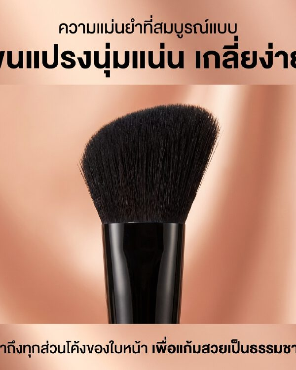<br><sub>泰语 · 美妆工具</sub></td>
    <td align="center">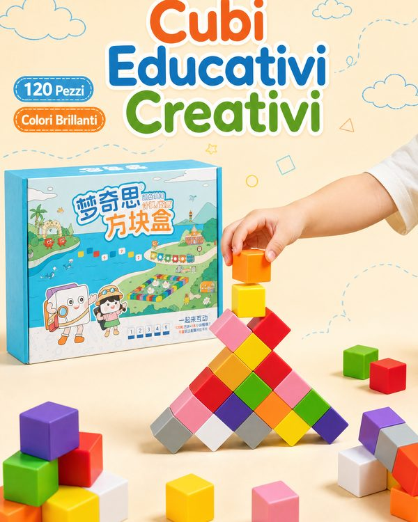<br><sub>意大利语 · 益智玩具</sub></td>
    <td align="center"><br><sub>泰语 · 护肤</sub></td>
  </tr>
  <tr>
    <td align="center"><br><sub>中文 · 氛围海报</sub></td>
    <td align="center"><br><sub>中文 · 运动服饰</sub></td>
    <td align="center"><br><sub>模特街拍</sub></td>
    <td align="center">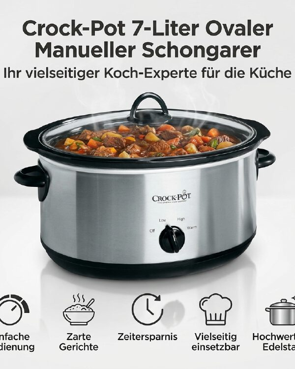<br><sub>德语 · 厨房电器</sub></td>
  </tr>
  <tr>
    <td align="center">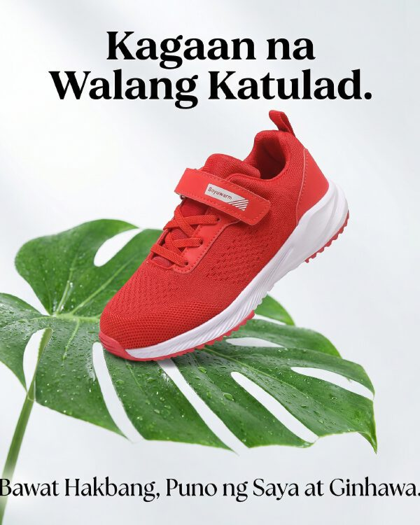<br><sub>菲律宾语 · 童鞋</sub></td>
    <td align="center"><br><sub>韩语 · 食品</sub></td>
    <td align="center">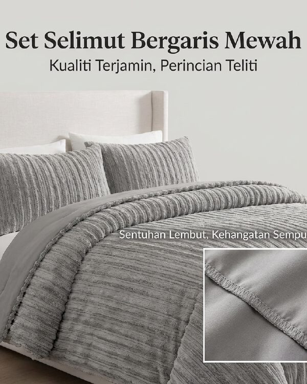<br><sub>印尼语 · 床品</sub></td>
    <td align="center">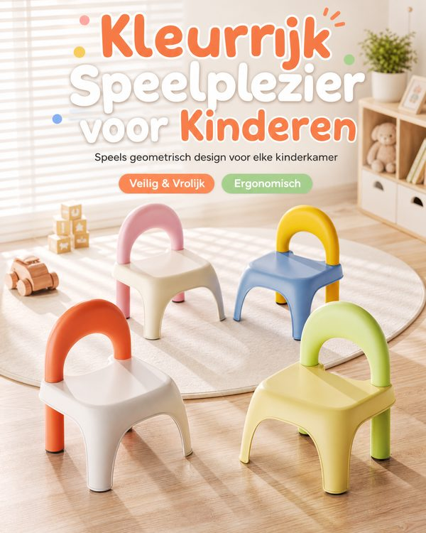<br><sub>荷兰语 · 儿童家具</sub></td>
  </tr>
</table>

### 一次出一整套详情图

    

<sub>“给这款方框眼镜做一套西班牙语详情图” → `generate-poster` 一次输出整套</sub>

### AI 改图：原图 → 效果

<table>
  <tr><th>一句话需求 · 技能</th><th>原图</th><th>效果</th></tr>
  <tr>
    <td><b>AI 抠图</b><br>“把这件 T 恤抠出来，透明底”<br><code>ai-image-matting</code></td>
    <td>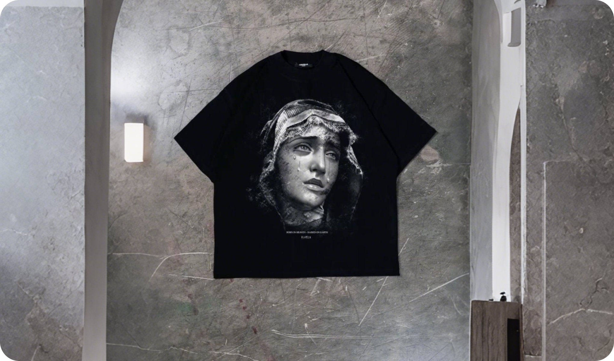</td>
    <td>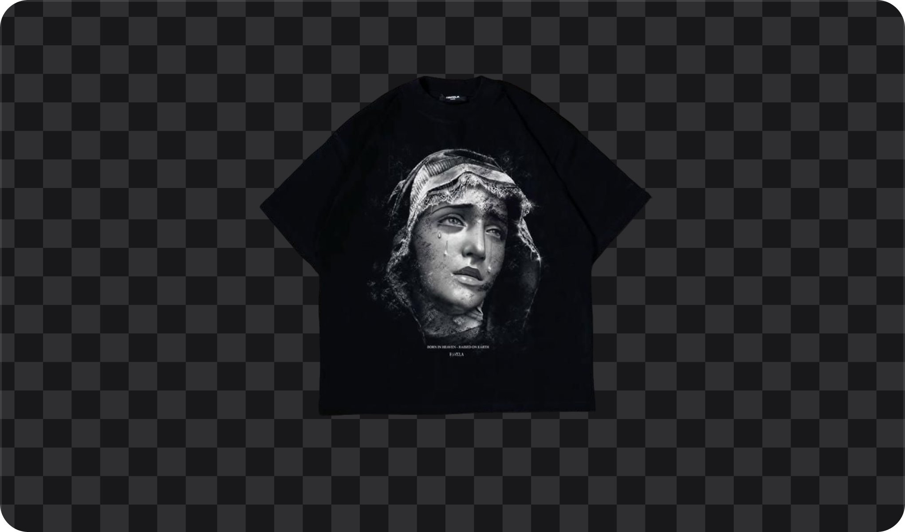</td>
  </tr>
  <tr>
    <td><b>场景替换</b><br>“换成北欧风客厅场景”<br><code>scene-replace</code></td>
    <td></td>
    <td></td>
  </tr>
  <tr>
    <td><b>商品替换</b><br>“把苹果换成我的精华瓶”<br><code>product-replace</code></td>
    <td></td>
    <td></td>
  </tr>
  <tr>
    <td><b>商品换色</b><br>“杯子换成柠檬黄”<br><code>product-color-change</code></td>
    <td>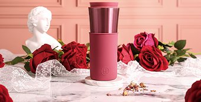</td>
    <td>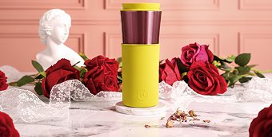</td>
  </tr>
  <tr>
    <td><b>图片翻译</b><br>“翻译成俄语，版式不变”<br><code>image-translate</code></td>
    <td>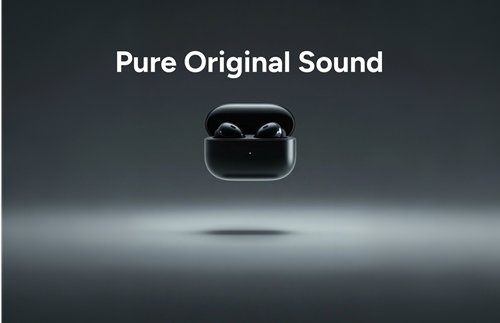</td>
    <td></td>
  </tr>
  <tr>
    <td><b>主图打标</b><br>“加上促销价和卖点标签”<br><code>main-image-tagging</code></td>
    <td></td>
    <td>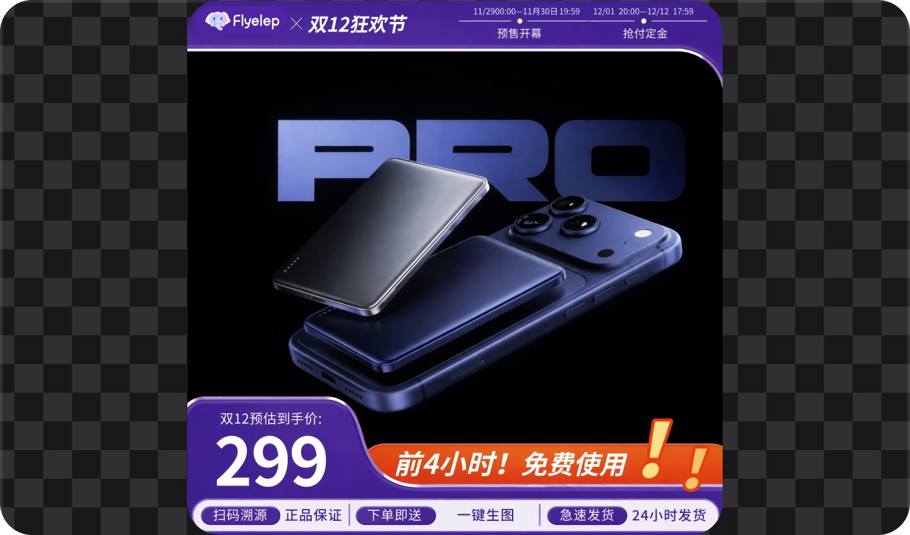</td>
  </tr>
  <tr>
    <td><b>智能延展</b><br>“延展成横版 16:9”<br><code>intelligent-extension</code></td>
    <td>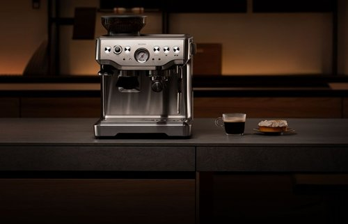</td>
    <td>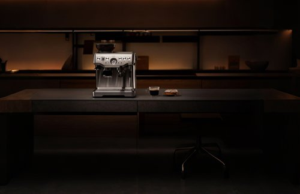</td>
  </tr>
  <tr>
    <td><b>无损放大</b><br>“放大 4 倍”<br><code>image-enlarge</code></td>
    <td>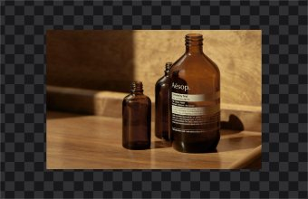</td>
    <td>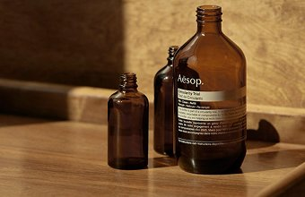</td>
  </tr>
</table>

### 爆款复刻 · 图层分离 · 多图融合

<table>
  <tr>
    <td align="center">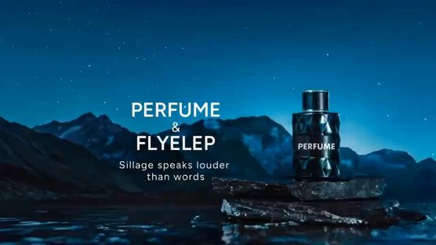<br><sub><code>gen-hot-image</code> 参考爆款，复刻同款</sub></td>
    <td align="center"><br><sub><code>image-layer-decompose</code> 拆成可编辑图层</sub></td>
    <td align="center">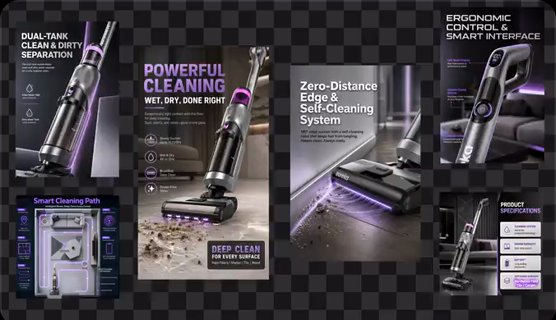<br><sub><code>long-image-fusion</code> 多图无缝拼长图</sub></td>
  </tr>
</table>

### 商品视频：点封面看成片

<table>
  <tr>
    <td align="center"><a href="https://cos-agent-2717.flyelep.cn/cos_ai_agent/2026-07-17/3654bab2ea14442eb8b51d19b538ad31.mp4">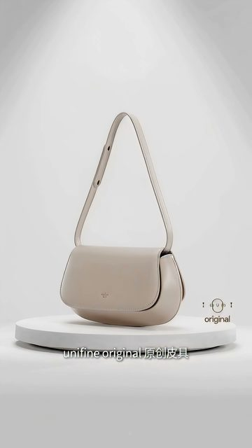</a><br><sub>▶ 品牌宣传片</sub></td>
    <td align="center"><a href="https://cos-agent-2717.flyelep.cn/cos_ai_agent/2026-07-17/70ee09ca557246afad23a86fe09e93c1.mp4">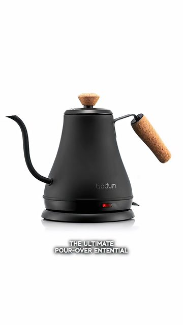</a><br><sub>▶ 带货种草</sub></td>
    <td align="center"><a href="https://cos-agent-2717.flyelep.cn/cos_ai_agent/2026-07-20/a199fcaeef8f46deb8ae76fc6ab18d78.mp4">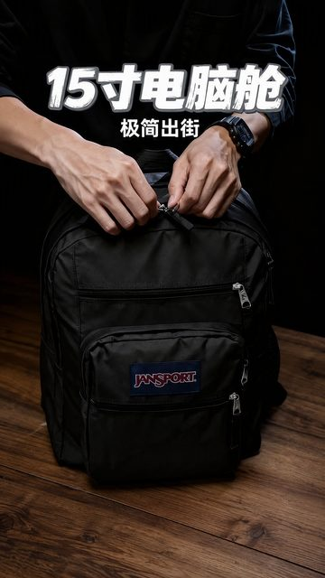</a><br><sub>▶ 口播讲解</sub></td>
    <td align="center"><a href="https://cos-agent-2717.flyelep.cn/cos_ai_agent/2026-07-17/6c5acb956dbe4551b00f0616fde20696.mp4">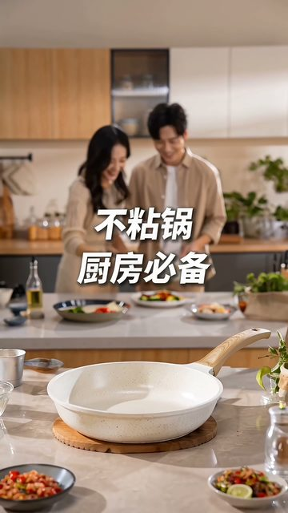</a><br><sub>▶ 剧情短片</sub></td>
  </tr>
</table>

<sub>`generate-video` 出主图视频、种草、口播、品牌片；`gen-hot-video` 参考爆款视频一键复刻。</sub>

---

## ✨ 为什么用它

| 以前 | 用 Flyelep Skills |
|---|---|
| 找设计师排期，一套主图等好几天 | 对 Agent 说一句话，几分钟出一套主图 + 详情图 |
| 抠图、换背景、换色、放大要在不同工具里来回切 | 20 个技能装在同一个 Agent 里，按需自动组合调用 |
| 跨境上架要逐张翻译、重做多语言图片 | 图片翻译一次出多语言版本，保留原版式 |
| 爆款风格学不来 | 发一张爆款图 / 爆款视频，用你的商品一键复刻 |
| 接 API 要读文档、写代码、处理轮询 | Skill 已内置接口参数、轮询和本地文件上传，Agent 直接调用 |

---

## 🚀 30 秒上手

### 1. 安装

任选一种：

- **ClawHub（OpenClaw）**：打开 [clawhub.ai/flyelepai](https://clawhub.ai/flyelepai)，选择需要的技能安装
- **skills CLI**：

  ```bash
  npx skills add FlyelepAI/agent-skills
  ```

  安装后是一个技能包 `flyelep-ai-skills`，已包含全部技能，自动识别 Claude Code、Cursor、Codex 等 Agent

- **手动安装（Claude Code / Cursor / Codex 等）**：把本仓库 `skills/` 下需要的技能目录复制到 Agent 的技能目录（如 Claude Code 的 `~/.claude/skills/`），或直接把仓库地址 `https://github.com/FlyelepAI/agent-skills` 发给 Agent 让它加载
- **WorkBuddy**：见下文 [WorkBuddy 接入](#workbuddy-接入)

### 2. 配置密钥

登录 [Flyelep 开放平台](https://www.flyelep.cn/controlboard) →「API Key」创建密钥（或联系 Flyelep 客服获取），然后告诉 Agent：

```
我的 Flyelep secretKey 是 sk-xxxx，后面调用 Flyelep 技能都用它。
```

> 密钥只放在你本地的 Agent 会话或环境变量里，不要提交到公开仓库。

### 3. 直接说需求

```
这是我的蓝牙耳机产品图（本地图片），帮我做一套 Amazon US 主副图，英文，5 张。
```

Agent 会自动：上传本地图片 → 调用 `generate-poster` → 轮询结果 → 把图片链接发给你。

---

## 🎯 能做什么

| 类别 | 场景 | 技能 |
|---|---|---|
| **出图** | 产品单图、白底图、主副图、套图、详情图、宣传图、Amazon A+ | `generate-poster` |
| | 自由创作、多比例创意图 | `async-free-creation` |
| | 参考爆款图，用你的商品复刻同款风格 | `gen-hot-image` |
| | 主图批量打卖点、价格标签 | `main-image-tagging` |
| **改图** | 抠图、换场景、换商品、换颜色 | `ai-image-matting` `scene-replace` `product-replace` `product-color-change` |
| | 局部重绘、改图中文字 | `partial-redrawing` `image-text-recognize` `text-edit` |
| | 超清、无损放大、智能延展（改比例） | `image-clarity-enhance` `image-enlarge` `intelligent-extension` |
| | 多图融合长图、图层分离 | `long-image-fusion` `image-layer-decompose` |
| | 多语言图片翻译 | `image-translate` |
| **视频** | 商品主图视频、种草视频、品牌宣传 | `generate-video` |
| | 参考爆款视频复刻（创意复刻 / 1:1 复刻） | `gen-hot-video` |
| **辅助** | 文案帮写、优化提示词 | `ai-writing-assist` |
---

## 💡 典型用法

### 案例 1：跨境卖家 3 分钟上新一套 Amazon 图

> “这是保温杯的白底图和卖点（316 不锈钢、12 小时保温、500ml），给我做一套 Amazon US 主副图，再做 3 张 A+ 详情图，英文。”

- **用到的技能**：`generate-poster`（主副图 + 详情图，A+ 尺寸 `970x600`）
- **产出**：一套主副图 + 3 张 A+ 图，英文卖点文案直接在图内
- **继续说**：“把这套图翻译成德语和日语版” → `image-translate` 一次出两种语言

### 案例 2：照着爆款做同款

> “这张是竞品的爆款主图，用我的口红产品图复刻同样的构图和氛围，出 4 张。”
> “再参考这条爆款短视频，用我的产品图做一条 15 秒的创意复刻视频。”

- **用到的技能**：`gen-hot-image`（爆款图片复刻）、`gen-hot-video`（爆款视频复刻）
- **产出**：4 张同风格商品图 + 1 条商品视频，商品外观保持你的原品

### 案例 3：一张随手拍变成详情页素材

> “这张是仓库里随手拍的运动鞋，先抠图，换成城市街头的场景，再做一张黑色款，最后放大 2 倍。”

- **用到的技能**：`ai-image-matting` → `scene-replace` → `product-color-change` → `image-enlarge`
- **产出**：透明底主体图、街拍场景图、黑色款场景图、高清放大图，Agent 自动串联，不用你逐个操作

### 案例 4：批量改价格、打标签

> “这 20 张商品图都按这张参考图的版式，打上‘限时 5 折’和价格 ¥99。”

- **用到的技能**：`main-image-tagging`
- **产出**：20 张统一版式的促销主图

---

## 📘 使用教程

### WorkBuddy 接入

**准备**：下载 [技能包 ZIP](https://github.com/FlyelepAI/agent-skills/archive/refs/heads/main.zip) 并解压，得到 `agent-skills` 文件夹。

**方式一：自然语言安装（推荐）**

1. WorkBuddy 对话框左下角点「选择工作空间」→「打开本地文件夹」，选择解压后的 `agent-skills` 文件夹
2. 在对话框输入：`帮我安装当前目录下的技能 SKILL.md`

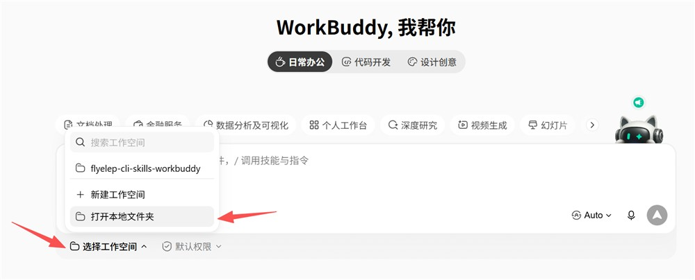

**方式二：手动安装**

对话框左下角点「+」→「技能」→「从本地添加技能」，导入根目录的 `SKILL.md`；也可以逐个导入 `skills/` 下各技能的 `SKILL.md`。

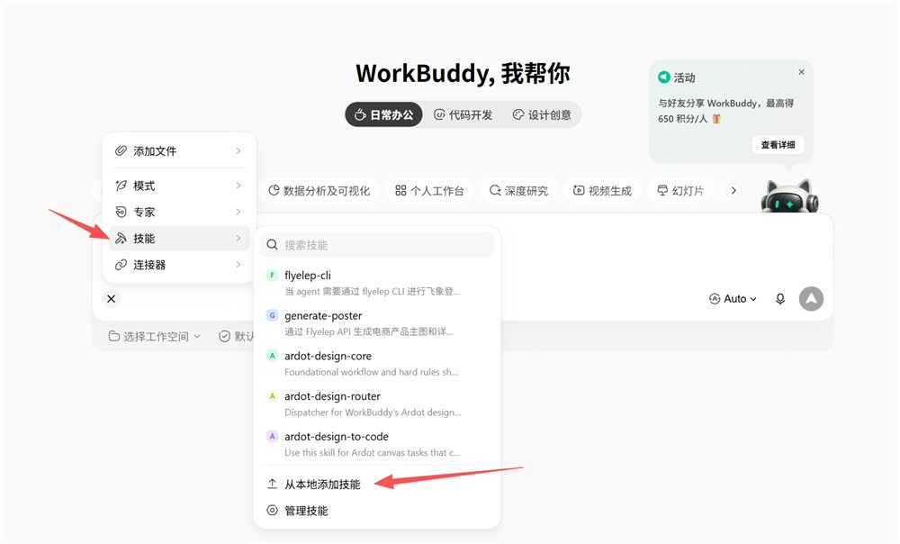

> **注意**：根目录 `SKILL.md`（技能名 `flyelep-ai-skills`）是总入口，记录了全部子技能的位置。只安装它时，`skills/` 文件夹必须在当前工作空间里（即方式一打开的文件夹），否则调用子技能会失败；逐个安装子技能则没有这个限制。
>
> 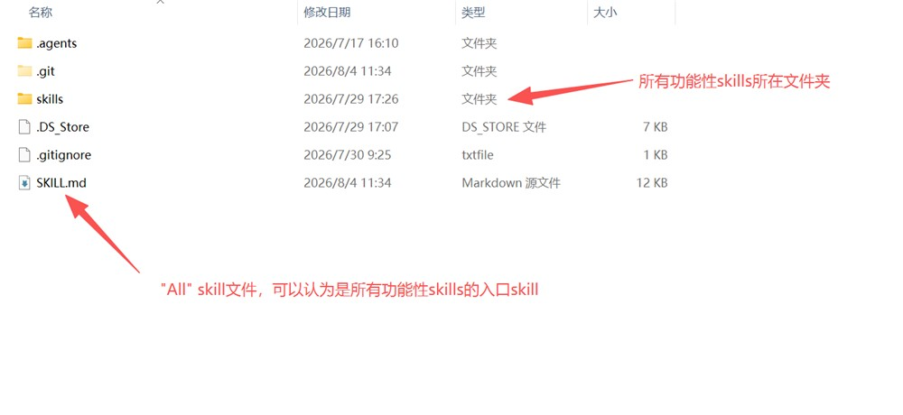

**验证**：安装后 WorkBuddy 会自动识别，问一句「有哪些 skills 技能」，回复里出现 Flyelep 技能即接入成功；再发送 secretKey 就能直接说需求。

### 常用说法

| 你想要 | 可以这样说 |
|---|---|
| 一套主图 | “帮我做一套淘宝主图，5 张，中文卖点：……” |
| 白底图 | “把这张产品图做成纯白底主图” |
| 指定平台和语言 | “面向 TikTok Shop 美国站，英文，1:1” |
| 选模型 | “用 Flyelep Image 2.5 生成” |
| 改比例 | “把这张图延展成 9:16 竖图” |
| 改图中文字 | “把图里的 ‘新品上市’ 改成 ‘Black Friday’” |
| 做视频 | “用这三张产品图做一条 10 秒主图视频，1080p” |
| 查余额 | “查一下我 Flyelep 账户还剩多少算力” |

### 小技巧

- **本地文件直接发**：Agent 会自动上传换成直链（24 小时内有效），再调用对应技能
- **素材越清晰越好**：换场景、换商品、换色时，同时给清晰原图 + 明确的文字描述，效果更稳
- **批量前先查余额**：大批量生成前让 Agent 先查一下剩余算力和并发上限
- **组合使用**：一次说清楚多步需求（抠图 → 换场景 → 放大），Agent 会按顺序自动串联
- **计费**：见 [Flyelep 官网](https://www.flyelep.cn) 左侧「算力 > 功能定价」

---

## 🧩 全部技能

| 技能 | 描述 |
|------|------|
| [generate-poster](skills/generate-poster/SKILL.md) | 生成电商产品单图、白底图、主副图、套图、详情图、宣传图 |
| [async-free-creation](skills/async-free-creation/SKILL.md) | 异步自由创作，可选模型生成 1-20 张创意图片 |
| [intelligent-extension](skills/intelligent-extension/SKILL.md) | 智能延展图片，支持批量处理和目标比例适配 |
| [image-translate](skills/image-translate/SKILL.md) | 识别并翻译图片中的文字，支持多图、多语言 |
| [partial-redrawing](skills/partial-redrawing/SKILL.md) | 对图片局部区域进行重绘，可结合文本提示词和参考图 |
| [image-enlarge](skills/image-enlarge/SKILL.md) | 无损放大图片，支持单张或批量 |
| [ai-image-matting](skills/ai-image-matting/SKILL.md) | 自动去除图片背景，支持批量抠图 |
| [scene-replace](skills/scene-replace/SKILL.md) | 替换图片背景场景，可结合参考图和文本描述 |
| [product-replace](skills/product-replace/SKILL.md) | 替换图片中的商品主体，保留背景和光影效果 |
| [product-color-change](skills/product-color-change/SKILL.md) | 智能识别商品并进行换色处理 |
| [image-clarity-enhance](skills/image-clarity-enhance/SKILL.md) | AI 超清增强图片清晰度，支持批量处理 |
| [long-image-fusion](skills/long-image-fusion/SKILL.md) | 多图融合，把多张图拼接融合成一张长图 |
| [image-layer-decompose](skills/image-layer-decompose/SKILL.md) | 图层分离，把图片拆成底图和最多 16 个透明图层 |
| [main-image-tagging](skills/main-image-tagging/SKILL.md) | 主图打标，按参考图版式把卖点和价格批量打到商品图上 |
| [image-text-recognize](skills/image-text-recognize/SKILL.md) | 文字识别，返回图片中每行文字和坐标 |
| [text-edit](skills/text-edit/SKILL.md) | 文字编辑，按原文→新文替换图片上的文字并保持版式 |
| [ai-writing-assist](skills/ai-writing-assist/SKILL.md) | AI 帮写，辅助生成创意文案和优化提示词 |
| [gen-hot-image](skills/gen-hot-image/SKILL.md) | 爆款图片复刻，基于爆款风格生成产品复刻图 |
| [gen-hot-video](skills/gen-hot-video/SKILL.md) | 爆款视频复刻，支持创意复刻与 1:1 复刻 |
| [generate-video](skills/generate-video/SKILL.md) | 电商视频生成，根据提示词和参考素材生成产品视频 |
各技能的能力概述与接口入口汇总见 [SKILL.md](SKILL.md)，完整参数说明见对应目录下的 `SKILL.md`。

---

## 🔧 开发者说明

- 接口文档：https://api.flyelep.cn/ ，接口基础地址 `https://www.flyelep.cn/prod-api`
- 所有技能统一在请求头传 `secretKey`（查询账户算力接口例外，密钥放在请求体中）
- 图片类异步任务用 `/poster/queryTaskResult` 查结果，视频类（`generate-video`、`gen-hot-video`）用 `/poster/videoGen/queryResult`
- AI 工具同步接口新增 `result.fileUrlList` / `result.taskId`，新接入优先读 `result`
- 所有技能均以各自目录中的 `SKILL.md` 为准；涉及素材入参的技能都内联了「本地文件上传」章节，只单独安装某一个技能也能完成上传

## 🔗 链接

- Flyelep 平台：https://www.flyelep.cn/
- ClawHub 发布页：https://clawhub.ai/flyelepai
- API 文档：https://api.flyelep.cn/

## License

MIT
